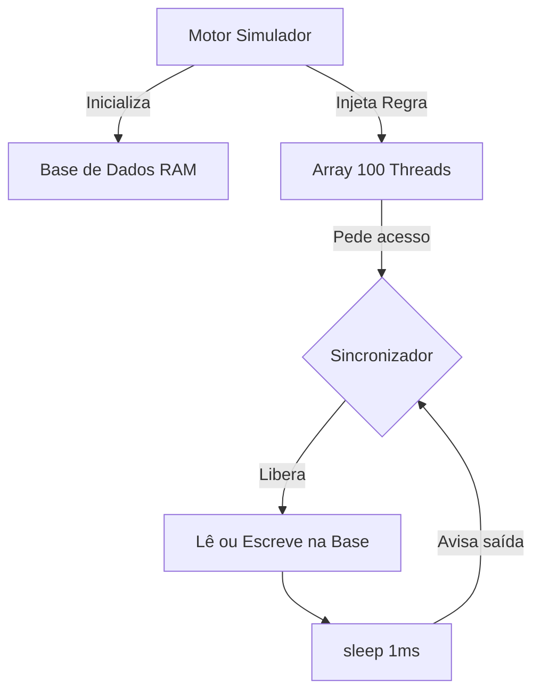

# Arquitetura da solução

O sistema utiliza uma arquitetura baseada em injeção de dependências, separando a orquestração dos laços de repetição da lógica de travas de concorrência, implementada através do padrão Strategy.

## Componentes e responsabilidades
*   **BaseDados:** Estrutura estática em RAM que detém o array de palavras. Fornece métodos puros de leitura e escrita. Não conhece threads ou travas.
*   **RegiaoCritica (Interface):** Contrato que define as regras de entrada e saída.
    *   *MutexStrategy:* Implementa exclusão mútua bloqueando todos indiscriminadamente.
    *   *ReadersPriorityStrategy:* Implementa lógica de semáforos/contadores favorecendo leitores.
*   **Trabalhador (Thread):** Lógica do operário. Instanciado recebendo a interface `RegiaoCritica` via construtor. Realiza o sorteio dos 100 acessos e a retenção de 1ms.
*   **Simulador (Motor):** Controlador dos laços de testes (101 proporções x 50 repetições), gerenciador do cronômetro (`currentTimeMillis`) e do log final de exportação.

## Fluxo de execução (Mermaid)
