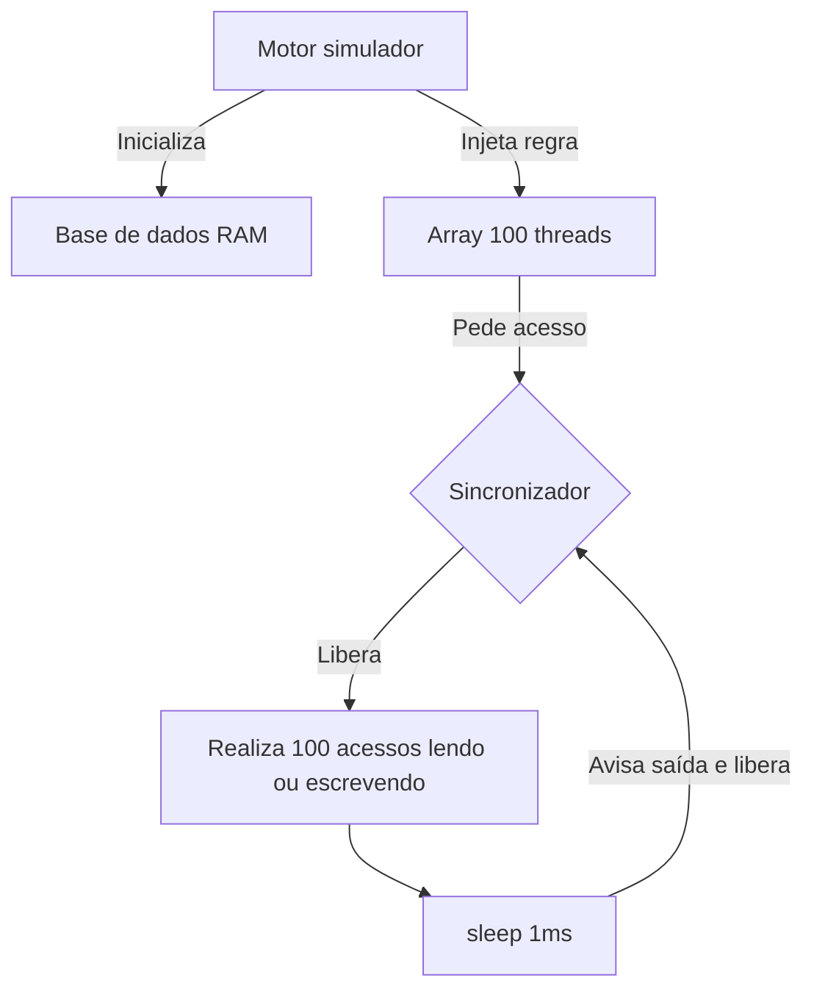

# Arquitetura e estratégia de concorrência

O sistema é dividido em três camadas principais: carregamento de dados em memória, orquestração de threads concorrentes e exportação de métricas.

## Fluxo de concorrência e comportamento das threads
Para fins didáticos, a base de dados inteira deve ser tratada como uma única região crítica, não havendo bloqueios em nível de registro individual. Independentemente de ser Leitor ou Escritor, a thread deve entrar na região crítica, realizar 100 acessos aleatórios e dormir por 1ms **ainda dentro da região crítica**, saindo apenas após acordar.

- **Leitor:** Acessa uma posição aleatória (entre 0 e 36.241), lê a String e armazena em uma variável local que será descartada.
- **Escritor:** Acessa uma posição aleatória (entre 0 e 36.241) e substitui o valor existente pela string `"MODIFICADO"`.

## Modelos de sincronização (as duas implementações)
1. **Solução Leitores e Escritores (com prioridade para leitores):** 
   - Vários leitores podem estar na região crítica simultaneamente.
   - Um escritor só pode entrar se a base estiver vazia (sem leitores e sem outro escritor).
   - Se houver leitores na fila, eles têm preferência sobre escritores esperando.
2. **Solução sem Leitores e Escritores (trava global):** 
   - Apenas uma thread (seja leitor ou escritor) entra na região crítica por vez. As outras 99 devem esperar.

## Estratégia de testes e coleta de dados (integração)
- **Isolamento de estado:** A cada nova rodada (das 50 repetições para cada proporção), o arranjo de threads não pode ser reaproveitado. Ele deve ser instanciado e embaralhado novamente.
- **Contrato de saída:** O programa Java não deve gerar gráficos, apenas cuspir um arquivo de saída estruturado (como CSV) contendo: `Proporcao_Leitores, Proporcao_Escritores, Tipo_Implementacao, Tempo_Medio_MS`.
- **Análise dos dados:** Um script Python (utilizando Pandas e Matplotlib) lerá o arquivo CSV gerado pelo Java para construir os gráficos de comparação de desempenho necessários para o relatório em LaTeX.

## Fluxo de execução
